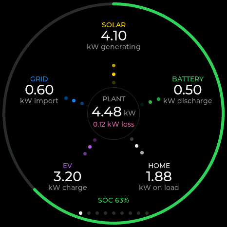
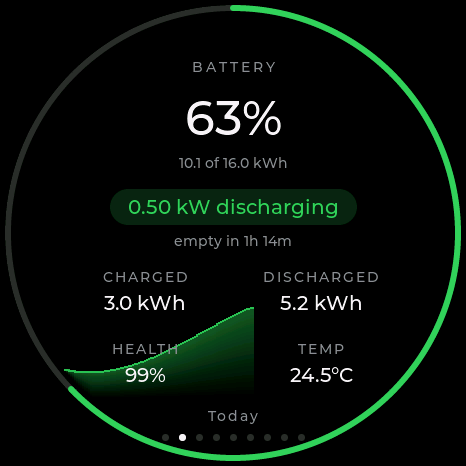
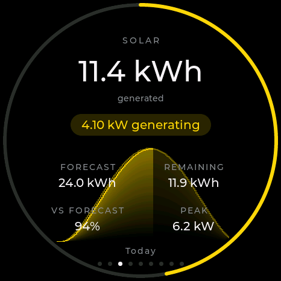
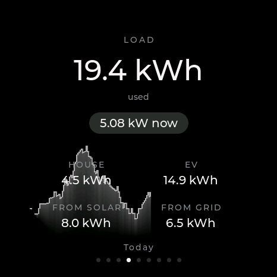
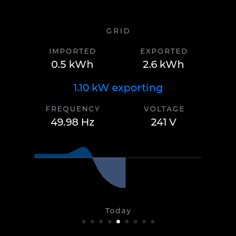
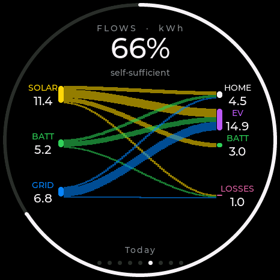
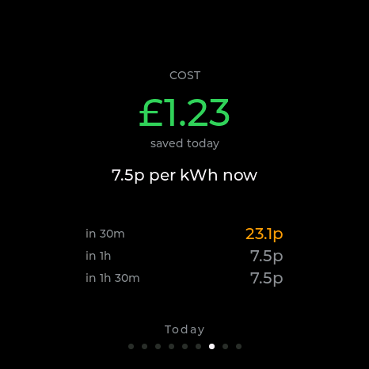
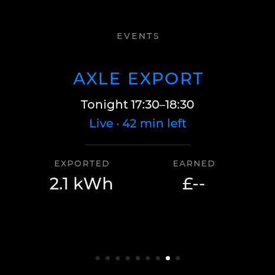
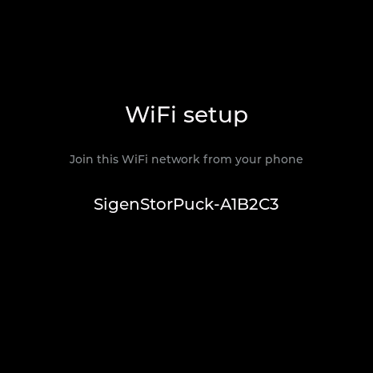
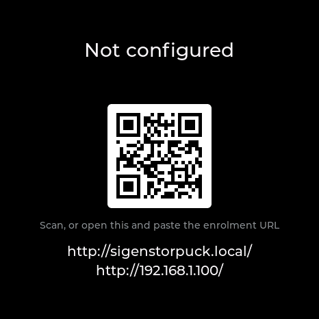

# SigenStorPuck

A round touchscreen status display for a Sigenergy SigenStor solar and battery system.

It runs on a Waveshare **ESP32-S3-Touch-AMOLED-1.75** — a 466×466 round AMOLED with
capacitive touch — and shows, at a glance from across the room:

- **live power flow** between solar, battery, home, EV charger and grid, with what the
  system itself is losing in conversion and standby;
- **battery** state of charge, health, temperature and time to full or empty;
- **solar** generation against the day's forecast;
- **consumption** for the day, and **grid** import and export with frequency and voltage;
- **where the day's energy went**, source by source;
- **what it all cost**, and the tariff slots coming up;
- the **grid events** you take part in — Octopus Saving Sessions, Happy Hours, Axle.

A second board is in **early-release testing**: the Waveshare
**ESP32-S3-Touch-AMOLED-2.41 (V1 revision)**, a 600×450 landscape AMOLED. It runs the same
firmware from this same repository, built for that board, with the screens re-laid for the
wide rectangle. The panel, touch and landscape UI are **confirmed on real V1 hardware** —
see **Hardware** below.

**Contents:** [Data sources](#three-ways-to-get-data--read-this-first) ·
[Screens](#the-screens) · [Buttons](#the-two-buttons) · [Installing](#installing) ·
[Settings](#settings) · [How the figures are worked out](#how-the-figures-are-worked-out) ·
[Looking after the screen](#looking-after-the-screen) ·
[What the Puck connects to](#what-the-puck-connects-to) ·
[Troubleshooting](#troubleshooting) · [The stand](#the-stand) · [Hardware](#hardware) ·
[Building it yourself](#building-it-yourself)

## Three ways to get data — read this first

The Puck can take its readings from one of three places, and it matters which, because
some screens and features need one of them.

**Modbus TCP — talking straight to your plant.** No other software involved. The Puck
reads your inverter or gateway directly over your own network. This remains the default
for a new installation.

**SigenStorDisplay Server.** A separate companion application that manages and logs a
Sigenergy plant, which the Puck can then read from. It unlocks the Flows, Cost and Events
screens, stepping back through past days, and complete daily charts.
**SigenStorDisplay has not been released yet.** The Puck already has full support for it
built in and ready for when it is, but until then those parts are unavailable.

**Home Assistant.** The Puck reads mapped entities through Home Assistant's REST API.
This is useful when Home Assistant is already the single collector for the inverter,
battery and meters: the Puck consumes that normalized home-energy environment without
becoming another direct Modbus client. The mappings are semantic and fully editable, so
this works with different inverter and battery integrations, not only Sigenergy. No
entity IDs are assumed.

### What works with which

| | Modbus | SigenStorDisplay Server | Home Assistant |
|---|:--:|:--:|:--:|
| **Power** screen | ● | ● | ● |
| **Battery** screen | ● | ● | ● |
| **Solar** screen | ● | ● | ◐ by default; ● with forecast configured |
| **Load** screen | ◐ headline and live draw only | ● | ◐ headline and live draw only |
| **Grid** screen | ● | ● | ◐ no frequency or voltage |
| **Flows** screen | — | ● | — |
| **Cost** screen | — | ● | — |
| **Events** screen | — | ● from SigenStorDisplay 0.45.0 | — |
| **Settings** screen | ● | ● | ● |
| Loss under PLANT | ● measured from the PV strings | ● | ◐ measured from the PV strings if you map them |
| Solar forecast | ● calculated on the Puck | ● from the server | ● disabled, Puck, or HA entities |
| Today's charts | ◐ from when the Puck was switched on | ● the whole day, and after a restart | ◐ restored from HA Recorder when available; otherwise from boot |
| Step back through past days | — | ● up to 7 days | — |
| Tariff rates and savings | — | ● | — |

● full · ◐ partial · — not available

On Modbus and Home Assistant the Flows, Cost and Events screens are removed altogether
rather than left showing dashes, so you get six screens instead of nine.

## The screens

**Swipe left and right across the glass to move between screens.** The row of dots along
the bottom shows how many there are and which one you are on. If the Puck is out of
reach, holding the **BOOT** button for 2 seconds moves to the next screen too, and the
auto-cycle can step through them on its own — see **Auto-cycle screens** under Settings.

Which screens appear at all is up to you — see **Screens** under Settings. The order is
always the one below, with Settings last.

| | |
|:--:|:--:|
|  |  |
| **Power** — what is happening right now. Solar at the top, then clockwise: battery, home, EV, grid, around the plant in the middle. Dots run along each leg in the direction the power is going, faster when there is more of it. The ring is your state of charge. The plant shows its own power and, under it, what the system is losing in conversion and standby — see [Reading the Power screen](#reading-the-power-screen).<br><br>*Works on all three sources when the corresponding values are available.* | **Battery** — charge level around the bezel, the energy stored out of the battery's capacity, the live charge or discharge rate, and how long until it is full or empty at that rate. Below that: charged and discharged today, battery health, and temperature.<br><br>*Works on all three sources. On Modbus, temperature and the daily totals need an inverter added under Plant; on HA, each figure needs its mapping.* |
|  |  |
| **Solar** — generation so far today, with the ring showing progress against the day's forecast. Then the forecast total, how much is still to come, how you are doing against it, and the expected peak. Behind the figures, today's generation curve is drawn over the forecast curve, so you can see where the day ran ahead or fell behind. A figure that isn't known yet shows `--` and keeps its place; with Home Assistant forecast entities, a figure you haven't mapped is left off. With no forecast at all the ring is hidden rather than shown empty.<br><br>*Works on all three sources.* Home Assistant can use no forecast, calculate one on the Puck, or map HA forecast entities. | **Load** — everything used today, with what is being drawn right now (house and car together). Below: the house's and the car's shares, and how much of it came from solar and from the grid. No ring: consumption has no ceiling to be a fraction of.<br><br>*Partial on Modbus and HA.* The headline total, live figure and locally recorded curve work. The four breakdown figures need a **SigenStorDisplay Server**. |
|  |  |
| **Grid** — imported and exported today, the live import or export rate, and the grid's frequency and voltage. Underneath, the day's grid power as a chart either side of a zero line: import above in blue, export below in a paler blue.<br><br>*Works on all three sources.* On Modbus, frequency and voltage need an inverter added under Plant, and today's import and export count from midnight or from when the Puck started, whichever is later. Home Assistant has no frequency or voltage mapping, and the two totals need their mappings. | **Flows** — where today's energy came from and where it went. Sources down the left, destinations down the right, one ribbon per path, each coloured by where it starts. From SigenStor Display 0.47.3 a fifth destination, **LOSSES** in pink, shows what the system itself used up on the way. The ring is how self-sufficient you have been, counting the car as part of your consumption.<br><br>**SigenStorDisplay Server Only.** |
|  |  |
| **Cost** — what you have saved today, the unit rate you are paying right now, and the next few tariff slots coloured against it: dearer in amber, the same or cheaper in grey. Slot times are shown relative to now ("in 30m").<br><br>**SigenStorDisplay Server Only.** | **Events** — the grid event that matters most right now: an Octopus Saving Session, a weekend Happy Hour, another free-import period, or an Axle event. The one on now, else the next one booked, else the last one to finish: when it is, how long is left or until it starts, and what it came to — energy cut and points for a saving session (`~` marks points not yet confirmed), how much of a Happy Hour's allowance you used, what was imported, or what an Axle event exported and paid.<br><br>**SigenStorDisplay Server Only**, version 0.45.0 or later. An older server shows "No events". |
|  | |
| **Settings** — always the last screen. Scan the code with your phone, or type either address into a browser, to reach the settings page. The code carries the IP address rather than the `.local` name, because phones are the devices least likely to resolve `.local`.<br><br>*Works on all three sources.* | |

Behind the battery, solar, load and grid screens is that day's own curve, drawn faintly so
it does not compete with the figures. With a **SigenStorDisplay Server** the whole day is
fetched every five minutes, so the curve is complete straight away and survives a restart.
On Modbus the curves fill from when the Puck started. In Home Assistant mode the Puck
starts one optional, entity-filtered Recorder backfill after its first successful live
poll: it restores today's available PV, battery and load curves in bounded two-hour
windows, with a normal live poll between windows. If Recorder is disabled, unavailable,
excludes an entity or has no history, the live readings continue normally and the affected
curves simply fill from boot. The grid curve always fills from boot on Modbus and HA.

### Reading the Power screen

Each leg shows a value, a unit and a word saying which way the power is going: *kW
generating*, *kW discharge* or *kW charge*, *kW on load*, *kW import* or *kW export*.

- **`-` over "idle"** means the figure was read and is zero. **`--`** means it could not be
  read at all. The two are kept apart on purpose: "nothing is happening" and "the Puck
  does not know" are different things.
- **Every leg is always drawn**, the EV included, so the shape of the star never changes.
- **PLANT** is the inverter and gateway together — the point home, the car charger and the
  grid all hang off. Its figure is the power through it, in either direction.
- **The line under PLANT** shows the plant's status when something needs your attention,
  and otherwise the system's own loss:

  | Under PLANT | Meaning |
  |---|---|
  | `0.19 kW loss` (pink) | The power the system is using up itself: conversion in the inverter and the battery, standby, battery heating. Hidden when it is 5 W or less, or not known. |
  | `2 ALARMS` | The plant is reporting alarms. Check the Sigen app. |
  | `STALE 3m` | The last good reading is this old: the source has stopped answering. |
  | `NO DATA` | No reading has arrived. |
  | `OFFLINE` | The source answered, but says the plant itself is unreachable. |

- **Off grid.** When the gateway has disconnected from the grid (its contactor is open,
  as in a power cut), the grid leg reads **Off** in amber over *contactor open*, and the
  GRID name is dimmed.
- **The ring** is the battery's state of charge, with the percentage at the bottom.

On the Power screen, **Solar + battery out = PLANT + loss**, and **PLANT + grid = home +
car**. Those two sums are how the loss and the house figure are worked out — see
[How the figures are worked out](#how-the-figures-are-worked-out).

### Status messages

Short messages appear at the top of the screen for a moment in answer to a
button: `CYCLE ON`, `CYCLE OFF`, `LIVE ONLY`, `RESTARTING`, `POWERING OFF`. On the day
screens, `LOADING` appears in the same place while a past day is being fetched, and the
figures show dashes until it arrives rather than today's figures under a past date.

### The two buttons

| | Press | Hold 2 seconds | Hold 5 seconds |
|---|---|---|---|
| **PWR** | Back one day | Auto-cycle on/off | Power off |
| **BOOT** | Forward one day | Next screen | Restart |

A press acts the moment the button comes back up — there is no double press, so nothing
waits to see whether a second one is coming. Holding through to 5 seconds passes the
2-second action on the way; that is harmless, because the device then restarts or powers
off.

The day buttons are **SigenStorDisplay Server Only** — on Modbus and Home Assistant there
is no stored history to step back into, and the buttons say `LIVE ONLY` instead. With a
server you can step back seven days. The day you are looking at is named just above the
page dots: in grey when it is today, in amber when it is not. Left alone for two minutes,
it goes back to today by itself. The day buttons do nothing on the Power, Events and
Settings screens, which have no date.

On a past day, the Battery, Solar, Load, Grid, Flows and Cost screens show that day. The
Power screen always stays live, and so do the battery's state of charge and the current
tariff rate; the live-rate pills and the battery's time-to-full line are hidden on a past
day, because a rate for right now under a past date would read as a mistake.

If the screen is off on a schedule, the first press of any button just wakes it up, and is
not otherwise acted on — pressing PWR to see the screen will not also step back a day.

On the **2.41″ landscape** board the buttons do the same, with one difference in what
"power off" means. That board has no power-management chip; its PWR button is a
battery switch. On battery, holding PWR for 5 seconds really does switch it off, and a
press switches it back on. On USB there is nothing to switch off, so it turns the screen
off and sleeps instead, and a press of PWR wakes it. (The third button, RST, is a
hardware reset.)

Holding **BOOT while plugging in** puts the board into USB download mode. That is the
chip's own behaviour and cannot be changed.

## Installing

### 1. Flash the firmware

Plug the Puck into a computer with a USB-C cable and open this page in **Chrome or Edge**:

### → [Install SigenStorPuck](https://markab.github.io/SigenStorPuck/)

It flashes over WebSerial — nothing to download and no drivers to install. Safari and
Firefox cannot do this, and neither can anything on an iPhone or iPad.

The installer asks which board you have — the **1.75″ round** or the **2.41″ landscape** —
and each flashes its own build. **The 2.41 is early-release testing** (V1 revision only —
the later V2 wires the board differently and is not currently supported); the 1.75 is the
primary board.

After the first flash the Puck updates itself — each board from its own build — see
**Firmware** below.

### 2. Join it to your WiFi

On first boot the Puck puts up its own WiFi network and shows you the name. Yours will
end in six different characters — it is that device's own name, so two Pucks side by side
do not clash.

<p align="center"></p>

1. On your phone or laptop, join that WiFi network. A setup page opens by itself; if it
   does not, browse to `http://192.168.4.1/`.
2. Tap **Configure WiFi**, pick your home network and enter its password.
3. If this is your second Puck, give it a **device name** on the same page so the two do
   not clash.
4. Save. The Puck joins your network and the screen changes to **Not configured**.

### 3. Open the settings page

The **Not configured** screen shows a QR code and the Puck's own address, given two ways:
the friendly name and the IP. Both appear because not every phone can resolve `.local`
names — if the first does nothing, use the second.

<p align="center"></p>

**Scan the QR code with your phone**, or type either address into any browser on the same
network. The code carries the IP, being the one that always works.

```
http://sigenstorpuck.local/
```

### 4. Choose and configure a data source

#### Direct Modbus

1. Check **Data source** is set to **Plant over Modbus**. It is out of the box.
2. Under **Plant (Modbus)**, enter the IP address of your inverter or gateway. Leave the
   port at `502` and the plant address at `247` unless you know otherwise.
3. Add your inverter as a device — this is what gives you battery temperature, the daily
   totals, grid frequency and voltage, and the PV-string readings the true Solar figure
   and the loss under PLANT come from — and a charger if you have one, for EV power.
4. Save, then **Restart Device** from the Danger section.

Two things to do outside the Puck, or it will not be able to connect:

- In the **Sigen app**, allow Modbus TCP access for the Puck's IP address. Access is
  granted per address, and a device that has not been added simply gets no reply.
- In your **router**, give the Puck a fixed (reserved) IP address, so the permission you
  just granted does not stop working the next time addresses are handed out.

Data should appear within a few seconds of the restart. The plant is happy to answer more
than one Modbus client, so the Puck can run alongside anything else already reading it.

#### SigenStorDisplay Server

Once it is available, set **Data source** to *SigenStor Display server*, then paste the
enrolment URL from the server's **Admin → Kiosk devices** page into the **Server** section
and save. The URL carries the server address and access token together. The token is a
read-only kiosk token: it can show the server's data and do nothing else, and revoking it
on the server cuts the Puck off at once.

The Puck works over plain HTTP on your own network, or over HTTPS to a server on the
internet, where it checks the server's certificate like a browser does.

#### Home Assistant

Prerequisites are a reachable Home Assistant instance, energy entities from any
integration, and a long-lived access token. In Home Assistant, create a dedicated local
non-administrator user for the Puck; sign in as that user, open the user profile, and
create a [**Long-lived access token**](https://developers.home-assistant.io/docs/auth_api/#long-lived-access-token).
Avoid using an administrator's everyday token. Revoking this token later immediately
removes the Puck's access.

1. Set **Data source** to **Home Assistant**.
2. Under **Home Assistant**, enter the base URL the Puck can reach, including the scheme
   and port where needed, such as `http://homeassistant.local:8123`.
3. Paste the long-lived access token. It is stored in the Puck's NVS, never compiled into
   firmware, and the settings page will only show a masked suffix after saving.
4. Map the entity IDs your installation provides. Grey Sigenergy entity IDs shown in the
   fields are example placeholders only: they are not configured or saved unless typed,
   and other Home Assistant integrations should use their own entity IDs.
5. Say whether your EV charger is **AC** or **DC** (or leave it on **Auto**), and map the
   PV string voltages and currents if your integration has them.
6. Optionally, choose whether solar forecasting is disabled, calculated on the Puck, or
   read from semantic Home Assistant entities. The default is disabled, preserving
   existing HA behaviour.
7. Save, use **Test Home Assistant connection**, then restart the Puck.

The Puck sends one [`POST /api/template`](https://developers.home-assistant.io/docs/api/rest/#post-apitemplate)
per live poll. Home Assistant renders only the
configured entities and their units into a compact response; the Puck does not fetch
entities one at a time or download all HA states. In this mode the Puck never opens a
Modbus connection.

After the first successful live poll following a boot, the Puck also reads filtered Home
Assistant Recorder history for the mapped entities needed by today's Solar, Battery and
Load curves. Consecutive two-hour requests keep each response bounded, and only one window
runs between live polls. Recorder is optional: an empty, excluded or unavailable entity
leaves a gap, and a failed window never invalidates live data or discards completed
windows. Transient failures are retried twice for the current window; malformed responses
stop the backfill. No previous day is downloaded or made browseable.

## Settings

Everything below is on the Puck's own settings page at `http://sigenstorpuck.local/`.
Most changes take effect straight away; the ones needing a restart are marked ↻. The page
lists the data sources in the order Server, Modbus, Home Assistant, and folds away the
ones you are not using.

### Network

<table>
<tr><th width="32%">Option</th><th>What it does</th></tr>
<tr><td><strong>Device name</strong> ↻</td><td>What the Puck calls itself on your network. The default is <code>sigenstorpuck</code>, reachable at <code>http://sigenstorpuck.local/</code>. Change it if you have more than one Puck.</td></tr>
</table>

### Data source

<table>
<tr><th width="32%">Option</th><th>What it does</th></tr>
<tr><td><strong>Plant over Modbus (LAN only)</strong> ↻</td><td><strong>The default.</strong> Read your inverter or gateway directly. Removes the Flows, Cost and Events screens, which need data only a server has.</td></tr>
<tr><td><strong>SigenStor Display server</strong> ↻</td><td>Read from a <strong>SigenStorDisplay Server</strong>. Not yet available.</td></tr>
<tr><td><strong>Home Assistant</strong> ↻</td><td>Read generic, explicitly mapped energy entities through Home Assistant's REST API. The Puck does not contact the plant over Modbus in this mode.</td></tr>
</table>

### Plant (Modbus)

*Used on the Modbus source.*

<table>
<tr><th width="32%">Option</th><th>What it does</th></tr>
<tr><td><strong>Gateway or inverter IP</strong></td><td>The address on your network of the device that speaks Modbus TCP.</td></tr>
<tr><td><strong>Port</strong></td><td><code>502</code> unless you have changed it on the plant.</td></tr>
<tr><td><strong>Plant address</strong></td><td><code>247</code> unless you have changed it.</td></tr>
<tr><td><strong>Slave ID</strong></td><td>The address of one device inside the plant, as shown in the Sigen app. <code>0</code> means the slot is unused. Four slots are available; all are optional.</td></tr>
<tr><td><strong>Type</strong></td><td><em>Inverter</em> or <em>Charger</em>. Adding an inverter gives you battery temperature, the daily totals, grid frequency and voltage, and its PV strings, which Solar and the loss under PLANT are measured from; adding a charger gives you EV power.</td></tr>
<tr><td><strong>DC charger</strong></td><td>Tick if that inverter has a vehicle charger built into it, so its DC output counts as EV power.</td></tr>
</table>

Every inverter's PV strings are read on each poll, which adds about a second per inverter.
An inverter that does not answer for its strings is left alone for ten minutes before it is
asked again, and in the meantime Solar and the loss fall back to the plant's own figure.

### Server

**SigenStorDisplay Server Only** — nothing here affects the Home Assistant or Modbus source.

<table>
<tr><th width="32%">Option</th><th>What it does</th></tr>
<tr><td><strong>Enrolment URL</strong></td><td>Paste the whole URL from the server's Admin → Kiosk devices page. It fills in the server address and access token together. The page shows the last four characters of the stored token so you can tell one device's enrolment from another's.</td></tr>
<tr><td><strong>Test server connection</strong></td><td>Fetches data once and reports exactly what happened — the quickest way to find a wrong address or a revoked token.</td></tr>
</table>

What each server version adds:

| SigenStorDisplay | Adds on the Puck |
|---|---|
| 0.13.0 | The minimum: live power, battery and today's totals |
| 0.14.0 | The plant's own power in the middle of the Power screen |
| 0.15.0 | The Solar screen's forecast |
| 0.16.0 | Whole-day charts, fetched from the server |
| 0.17.0 | The car's share of each flow on the Flows screen |
| 0.18.0 | The Load screen's day chart |
| 0.24.0 | The forecast curve behind the Solar screen's chart |
| 0.25.0 | The Grid screen's day chart |
| 0.26.0 | Grid frequency and voltage |
| 0.45.0 | The Events screen |
| 0.47.3 | House load measured on the AC side; the loss under PLANT; LOSSES on the Flows screen |
| 0.47.6 | The loss under PLANT measured from the PV strings |
| 0.47.7 | Solar measured from the PV strings |

An older server still works: whatever it does not send simply does not appear.

### Home Assistant

The URL, token, and at least one mapping are required to start polling. No single entity
mapping is universal across HA integrations, so mappings are individually optional; for
a useful power diagram, configure PV, grid, battery and plant power. SOC and today's
totals enable their corresponding figures.

| Mapping | Canonical meaning and sign |
|---|---|
| PV power | Solar generation, positive, in W or kW |
| Grid power | Positive importing, negative exporting, in W or kW |
| Battery power | Positive charging, negative discharging, in W or kW |
| Home/load power | Positive consumption, in W or kW; used as-is when mapped (see below) |
| EV power | Positive charging draw, in W or kW, with whether the charger is AC or DC |
| Plant/system power | Integration's total active plant power, in W or kW: negative while the plant takes AC in |
| Off-grid state | `on`/`true`/`1`/`off_grid`, or the corresponding false value |
| Battery SOC / SOH | Percentage with HA unit `%` |
| Battery capacity | Wh or kWh |
| Battery temperature | °C (`°C`, `C`, or `degC`) |
| Today's six energy totals | PV generation, load, import, export, battery charge and discharge, each in Wh or kWh |
| PV1–PV4 voltage and current | Optional: each string's voltage in V or mV and current in A or mA, for Solar and the loss under PLANT |
| Solar forecast | Today's total and remaining energy in Wh or kWh, actual-vs-forecast in `%`, and peak power in W or kW |

Every mapping can be overridden or cleared individually. How the house load, Solar and the
loss are worked out from these is under
[How the figures are worked out](#how-the-figures-are-worked-out). In short:

- **Map plant power.** Without it the house figure includes the system's own losses, and
  the loss under PLANT is not shown.
- **Map the PV strings if you can.** Without them Solar is the integration's PV power,
  which is reported after the system's losses, so the loss misses most of what happens in
  daylight. A string pair counts only when both halves are mapped, and if any mapped
  string is unavailable the Puck falls back rather than show a total short by a string.
- **Leave home/load power blank** unless you trust it. A mapped sensor is used as it is,
  and Sigen's own consumed-power sensor may count the losses as house load.

Whether the EV charger is **AC** or **DC** matters, because only an AC charger is on the
house wiring. **Auto**, the default, treats an entity ID containing `dc_charger` as DC
(the default mapping is the inverter's DC charger) and anything else as AC.

Leaving the optional EV mapping blank explicitly means there is no separate EV leg and
uses zero in those equations. Mapping an EV entity whose current state is unavailable
does **not** turn it into zero, and prevents the derivations that need it until it
recovers.

HA values keep the units used by every screen: kW, kWh, %, and °C. `W` is converted to
`kW`, and `Wh` to `kWh`. Missing units, unsupported units, `unknown`, `unavailable`, and
non-numeric states remain unknown rather than becoming zero. Correct the HA entity or
template sensor so its `unit_of_measurement` is one of the supported units.

HTTP is supported for a trusted LAN. HTTPS uses the firmware's trusted CA bundle and
validates the certificate; there is no insecure TLS mode. Use a hostname whose
certificate chains to a CA trusted by the device. The Puck refuses redirects, so the token
is never forwarded to another host.

### Solar forecast

Direct Modbus always calculates the forecast on the Puck. With a
**SigenStorDisplay Server** it comes from the server. Home Assistant users explicitly
choose **Disabled**, **Calculate on Puck**, or **Home Assistant entities**; missing settings
from an older installation default safely to Disabled.

**Calculate on Puck** fetches the weather from [Open-Meteo](https://open-meteo.com/) once
an hour — under a kilobyte — and works the forecast out on the device, using the same
model as SigenStorDisplay, so a house running both sees the same forecast on each. (The
server also blends in measured weather for hours already past, so expect small differences
on a changeable afternoon.) Editing a roof field recomputes straight away; moving the
location fetches again. For **Home Assistant entities**, the semantic mappings may point
to any suitable HA integration. Today's total forecast is required to make the Solar
screen meaningful; remaining energy, actual-vs-forecast percentage, and peak power are
optional. They are included in the same compact HA template request as live data and any
that isn't mapped is left off the Solar screen from the next restart.

<table>
<tr><th width="32%">Option</th><th>What it does</th></tr>
<tr><td><strong>Latitude / Longitude</strong></td><td>Where your panels are. <strong>Leave both blank for no forecast</strong> — the Solar screen then hides its ring rather than showing an empty one. Setting a location also tells the Puck your timezone, which is what lines the daily charts up with your own midnight and the screen-off hours with your own clock.</td></tr>
<tr><td><strong>System loss</strong></td><td>Everything between the panels' rating and your meter: inverter efficiency, wiring, dirt on the glass. <code>0.85</code> is a sensible starting point.</td></tr>
<tr><td><strong>Inverter cap</strong></td><td>The most your inverter can put out, in kW. <code>0</code> means no limit.</td></tr>
<tr><td><strong>Size (kWp)</strong></td><td>An array's rating. <code>0</code> leaves that slot unused. Up to four arrays.</td></tr>
<tr><td><strong>Tilt</strong></td><td>The angle from flat. <code>0</code> is horizontal, <code>35</code> is a typical pitched roof, <code>90</code> is vertical.</td></tr>
<tr><td><strong>Azimuth</strong></td><td>A compass bearing: <code>180</code> due south, <code>90</code> east, <code>270</code> west, <code>0</code> north.</td></tr>
</table>

### Display

*All of these work on all three sources.*

<table>
<tr><th width="32%">Option</th><th>What it does</th></tr>
<tr><td><strong>Brightness</strong></td><td>Normal running brightness, 0 to 255.</td></tr>
<tr><td><strong>Poll interval</strong></td><td>How often to fetch new readings, in seconds. <code>5</code> is the default.</td></tr>
<tr><td><strong>Dim after</strong></td><td>Seconds of no touching before the screen dims. <code>0</code> never dims. A touch brings it straight back.</td></tr>
<tr><td><strong>Dimmed brightness</strong></td><td>How dim it goes. It dims rather than blanking, so it stays readable from across the room.</td></tr>
<tr><td><strong>Screen off from / until</strong></td><td>Hours to switch the screen off completely, for overnight. <strong>Off means off, not dimmed.</strong> Any button brings it back for 30 seconds, and touching it keeps it on for as long as you are using it. Blank both boxes to leave the screen on all the time; the two times cannot be the same. The window may run past midnight, as an overnight one does. The times are the Puck's own local time, which the page shows next to the boxes so you can check it is right.</td></tr>
<tr><td><strong>Orientation</strong> ↻</td><td>Quarter turns, <code>0</code> to <code>3</code>, for mounting the Puck whichever way round suits. Touch turns with it.</td></tr>
<tr><td><strong>Auto-cycle screens</strong></td><td>Whether the Puck moves to the next screen on its own. Holding PWR for 2 seconds flips the same switch, and either way the choice survives a restart.</td></tr>
<tr><td><strong>Auto-cycle every</strong></td><td>Seconds between screens while it is on. Switching the auto-cycle off keeps the interval you set.</td></tr>
<tr><td><strong>Sweep every</strong></td><td>Minutes between a brightness band sweeping across the screen. This evens out wear on the panel, which matters on an AMOLED showing much the same picture all day. <code>0</code> turns it off.</td></tr>
<tr><td><strong>Screens</strong> ↻</td><td>A tick per screen for whether it appears at all, and a second for whether the auto-cycle stops on it — a screen worth swiping to is not always one worth parking on. Power and Settings are always shown, so their boxes are fixed. On Modbus and Home Assistant, Flows, Cost and Events are struck through and cannot be ticked.</td></tr>
</table>

### Firmware

<table>
<tr><th width="32%">Option</th><th>What it does</th></tr>
<tr><td><strong>Install</strong></td><td>Downloads the newer release and applies it. The Puck restarts on its own. Only appears when there is one. Your settings are kept.</td></tr>
<tr><td><strong>Check now</strong></td><td>Looks for a newer release straight away.</td></tr>
<tr><td><strong>Check for a newer release when this page is opened</strong></td><td>Off by default, so the Puck contacts nothing but your own network unless you ask it to. Tick it to be told about new releases when you open this page. Installing one is always a separate click.</td></tr>
</table>

### Danger

<table>
<tr><th width="32%">Option</th><th>What it does</th></tr>
<tr><td><strong>Restart Device</strong></td><td>Reboots it. Needed after any ↻ change above.</td></tr>
<tr><td><strong>Forget server and token</strong></td><td>Clears your server details. You will need the enrolment URL again.</td></tr>
<tr><td><strong>Forget Home Assistant token</strong></td><td>Clears only the HA credential; the URL and semantic mappings remain so a replacement token can be entered without rebuilding the configuration.</td></tr>
<tr><td><strong>Forget WiFi and restart</strong></td><td>Clears the WiFi password and brings the setup network back, for moving the Puck to a different network.</td></tr>
</table>

## How the figures are worked out

The Puck is a display, not a calculator. With a **SigenStorDisplay Server** every figure
arrives already worked out, and the Puck shows it as sent. On **Modbus** and **Home
Assistant** there is no server to ask, so the Puck works out three figures itself, with the
same formulas the server uses:

```
solar  = the larger of (PV strings, the plant's PV figure)
home   = grid + plant − AC charger
losses = solar − battery − plant − DC charger
```

All in kW. *grid* is positive when importing, *battery* positive when charging, and
*plant* is the power through the inverter's AC terminals — negative while it takes power
in from the grid, positive while it supplies the house.

**Solar is what the panels delivered**, measured at the inverters' PV inputs: voltage ×
current summed over every string. Sigenergy's own PV figure is reported after the system's
losses, so in weak sun it can read nothing while the panels are delivering 0.1 kW. The
larger of the two is taken so that sensor error in low light never shows less than
Sigenergy's figure. Without string data, Solar is Sigenergy's figure.

**The house load is measured on the AC side.** The older sum, `PV − battery + grid − EV`,
mixed the DC side (panels and battery) with the AC side (grid), so the system's own
losses — about 0.4 kW on a night spent charging from the grid — counted as house load.
An AC charger is on the house wiring, so it comes off the house figure. Without the plant's
power the Puck falls back to the older sum, which counts the losses as house load.

**The loss is everything that goes in and does not come out**: conversion in the inverter
and battery, standby, battery heating. It uses the same Solar figure, so the Power screen
adds up: Solar + battery out = PLANT + loss. A DC charger draws from the DC side, before
the plant's AC terminals, so it counts here rather than in the house figure. It is not
rounded up to zero: a small negative is sensor noise, and hiding it would hide a mistake.

A worked example, from a sunny-ish afternoon with the battery helping out:

| | kW |
|---|---|
| PV strings | 0.25 |
| Sigenergy's PV figure | 0.07 |
| Battery (discharging) | −0.87 |
| Plant (supplying the house) | 0.93 |
| Grid | 0 |
| **Solar** = max(0.25, 0.07) | **0.25** |
| **Home** = 0 + 0.93 − 0 | **0.93** |
| **Loss** = 0.25 + 0.87 − 0.93 | **0.19** |

Today's solar total on Modbus comes from Sigenergy's daily-generation counter, which is
reported after the losses, so it reads a few percent below the server's figure for the
same day. That is expected.

## Looking after the screen

An AMOLED showing much the same picture all day will wear unevenly, so the Puck spreads
the wear several ways:

- **It dims when nobody is touching it** (*Dim after*), rather than blanking: a status
  display you have to wake to read is a worse one.
- **A faint band sweeps across** every few minutes (*Sweep every*).
- **The auto-cycle** moves the picture between screens.
- **It switches off overnight** (*Screen off from / until*). That is a real panel power-down,
  not brightness zero, and it beats everything above put together for the hours nobody is
  in the room.

## What the Puck connects to

- **Your data source** — the plant over Modbus, your SigenStorDisplay Server, or Home
  Assistant — on every poll.
- **An internet time server** (`pool.ntp.org`, then `time.nist.gov`) at start-up and now
  and then after. The Puck needs the time before it can check a certificate. It asks for UTC; local time
  comes from your data source or your solar location.
- **Open-Meteo**, once an hour, only when the Puck calculates the solar forecast itself and
  a location is set. Only the coordinates are sent.
- **This project's GitHub Pages site**, only when you press **Check now** or **Install**, or
  have ticked the box to check when the settings page opens.

Nothing else. No server address, token or WiFi password is ever compiled into the
firmware: they live in the Puck's own storage, set through its settings page, and the
settings page shows only the last few characters of a token.

## Troubleshooting

| On screen | What it means |
|---|---|
| **WiFi setup** | Not on your network yet. Join the setup network shown and follow step 2. |
| **Connecting to WiFi** | Joining your network. It should pass in a few seconds. |
| **Not configured** | On WiFi, but it does not know where to get data. Follow steps 3 and 4. |
| **Waiting for data** | Configured, but nothing has arrived yet. Normal just after a restart. |
| **Waiting for clock** | It needs the time from the internet before it can make a secure connection. Passes on its own once your network lets it reach an NTP server. |
| **No data** | The active source failed and the reason appears underneath. Check its URL/address and connection test; for Modbus, also check the Puck is still allowed in the Sigen app. |
| **Re-enrol needed** | *Server only.* The access token has been revoked. Create a new kiosk device and paste the fresh enrolment URL. |
| **HA token rejected** | Home Assistant returned 401/403. Replace the long-lived token and check that it belongs to an active user. |
| **entities unavailable** | HA answered, but every mapped entity is `unknown`, `unavailable`, non-numeric, or has an unsupported/missing unit. Use the connection test for detail and inspect those entities in HA Developer Tools. |
| `LIVE ONLY` | You pressed a day button on Modbus or Home Assistant, neither of which has historical backfill in this version. |
| `STALE 3m` under PLANT | Readings have stopped arriving; the figures are that old. The source has stopped answering — see **No data** above. |
| `--` on a leg | That figure could not be read at all. On Home Assistant, check its mapping and unit. |

If a Modbus setup worked and then stopped, the usual cause is the Puck's IP address
changing, which quietly invalidates the permission granted in the Sigen app. Reserve the
address in your router and grant it again.

**The house figure is lower than the Sigen app's.** Expected: the app counts the system's
own losses as house load, and the Puck shows them separately under PLANT.

**Solar reads higher than the Sigen app's.** Also expected: the Puck shows what the panels
delivered, and the app shows what is left after the losses. The gap is the loss under
PLANT.

**No loss under PLANT in daylight, on Modbus.** The PV strings are not being read: check
that an inverter is added under Plant. On Home Assistant, map the PV string voltages and
currents, and plant power.

**The charts start at 1 am, or the screen goes off an hour late.** The Puck does not know
your timezone. On Modbus or Home Assistant, set a solar location: Open-Meteo reports the
local time there, daylight saving included.

## The stand

A desk stand for the Puck. It seats into the round face at the front and sits on the
moulded base. Three parts in the file: the stand itself and two small caps at the top
edge, either side of centre.

<p align="center"></p>

| | |
|---|---|
| [`SigenStorPuckStand.3mf`](docs/stl/SigenStorPuckStand.3mf) | The one to print. Carries all three parts, positioned as designed. |
| [`SigenStorPuckStand.stl`](docs/stl/SigenStorPuckStand.stl) | The same geometry as a single mesh. |

60 × 45 × 109 mm overall.

## Hardware

**1.75″ round** — the primary, verified board.

| | |
|---|---|
| Board | Waveshare ESP32-S3-Touch-AMOLED-1.75 |
| Display | 466×466 round AMOLED, CO5300 over QSPI |
| Touch | CST9217, I2C |
| MCU | ESP32-S3R8, 8 MB PSRAM, 16 MB flash |
| Also on board | AXP2101 PMIC, PCF85063 RTC, QMI8658 IMU |

**2.41″ landscape — early-release testing.** The **V1 hardware revision specifically** (the
later V2 routes the display and touch resets through the board's I/O expander and repurposes
GPIO21 as the panel's tearing-effect line, so it needs its own profile and is not currently
supported — check which revision your board is before flashing; a V1 carries no "Rev2.0"
silkscreen). On V1 the panel (RM690B0, driven with an SH8601-compatible init sequence over a
GPIO21 reset), the FT6336 touch and the landscape UI are **confirmed on real hardware**,
including the software portrait-to-landscape rotation.

| | |
|---|---|
| Board | Waveshare ESP32-S3-Touch-AMOLED-2.41, **V1 revision** |
| Display | 600×450 landscape AMOLED, RM690B0 over QSPI (SH8601-compatible init) |
| Touch | FT6336 (FocalTech FT5x06 family), I2C |
| MCU | ESP32-S3R8, 8 MB PSRAM, 16 MB flash |
| Also on board | PCF85063 RTC, QMI8658 IMU, TCA9554 I/O expander (no AXP2101 PMIC); V1 drives the display and touch resets from GPIO directly |

## Building it yourself

The firmware is PlatformIO, Arduino and LVGL 8.4. Four environments:

| Environment | What it builds |
|---|---|
| `puck` | Firmware for the 1.75″ round board |
| `puck241` | Firmware for the 2.41″ landscape board |
| `sim` | The round screens on your desktop, in an SDL window |
| `sim241` | The landscape screens on your desktop |

```bash
pio run -e puck -t upload -t monitor
```

For the 2.41″ landscape board (early-release testing) use the `puck241` environment:

```bash
pio run -e puck241 -t upload -t monitor
```

### The simulator

Screens are developed against canned payloads on the desktop rather than by reflashing,
which is where every screenshot above came from. It needs SDL2 (`brew install sdl2` on a
Mac) and should be run from the repository root so it finds `test/fixtures`.

```bash
pio run -e sim && .pio/build/sim/program
```

```bash
pio run -e sim241 && .pio/build/sim241/program
```

| Key | Does |
|---|---|
| `n` / `p` | Next or previous fixture — eleven payloads covering the awkward states: off grid, unread registers, a null day, stale data, grid charging |
| `[` / `]` | Previous or next screen |
| `d` | Print the parsed data behind what you are looking at |
| `o` | Cycle the WiFi-setup and Not-configured overlays |
| `-` / `=` | Step the day back or forward |
| `_` / `+` | Step the day into its still-loading state |
| `r` | Toggle the auto-cycle |
| `e` | Step through the grid events |

Options:

- `--shot <dir>` renders every screen against every fixture to BMP files and exits — the
  quickest way to check a change across every state at once. It prints the graphics
  memory pool's usage at the end.
- `--modbus` previews the shorter six-screen arrangement also used by Home Assistant. It
  combines with `--shot`.
- `--selftest` runs the checks that need no hardware, headless: the Modbus register
  decoder and its PV-string reads, the house-load, Solar and loss formulas through every
  source, the server payload parser and fixtures, Home Assistant template, payload,
  Recorder parsing and units, the day series, grid events, source capabilities, the
  history ring, button gestures, the solar forecast model (checked against figures from
  the server's own code) and the screen-off window.

```bash
pio run -e sim && .pio/build/sim/program test/fixtures --shot /tmp/shots
```

```bash
pio run -e sim && .pio/build/sim/program --selftest
```

### Where things are

| Path | What is there |
|---|---|
| `src/` | Code shared by the firmware and the simulator: the data model and parsers, the Modbus decoder, the Home Assistant parser, the house-load and loss formulas, the solar forecast, the history ring |
| `src/device/` | Everything that needs the real board: WiFi, settings storage, the settings page, the poll task, the network clients, the power chip, the updater |
| `src/ui/` | The round screens |
| `src/ui_landscape/` | The landscape screens |
| `src/sim/` | The desktop simulator and the self-test |
| `src/board_config.h` | Every pin and tunable, with `board_1p75.h` and `board_2p41.h` for each board |
| `test/fixtures/` | The canned payloads the simulator and self-test use |
| `tools/` | Font generation and release packaging |
| `web/installer/` | The browser installer page |

Fonts are subsets of Montserrat, regenerated by `tools/generate_fonts.sh`: the built-in
LVGL fonts cannot draw `£`, `°` or `·`.

### Releases

Every push and pull request is built by GitHub Actions. A release is cut by bumping
`PUCK_FW_VERSION` in `src/board_config.h` and pushing a matching `v*` tag: the build
attaches each board's firmware and whole-flash image to the GitHub release, and the push
to `main` redeploys the installer page, whose per-board manifest is what the Puck's
**Check now** reads. If that deploy ever fails on a GitHub hiccup, start a clean run with
`gh workflow run build --ref main`.

## Home Assistant V1 scope

Home Assistant provides live power, battery values, configured today's totals and an
optional solar forecast from HA entities or the Puck's native model. A single optional
Recorder backfill can restore today's chart after restart using bounded two-hour requests;
without usable Recorder history, the same charts fill from live polls beginning at boot.
Previous-day browsing, past-day chart retrieval, detailed source-to-sink flows, tariffs and
costs/savings remain deliberately unimplemented. The day controls therefore remain
`LIVE ONLY` in HA mode.
